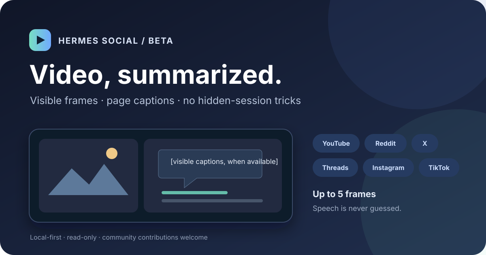

# Hermes Social (Beta)

<p align="center"></p>

Read-only local MCP server and CLI for visible pages and video frames on YouTube, Reddit, X, Threads, Instagram, TikTok, Facebook, and LinkedIn. Uses a dedicated Microsoft Edge profile and Node.js built-ins—no API key, cloud scraper, or npm dependency.

> Help make beta better: test your platform, report UI changes, improve docs, or send a pull request. Start with [CONTRIBUTING.md](CONTRIBUTING.md); include platform, steps, and sanitized output—never cookies, passwords, or private profile data.

## What works

- Search, read, feed, manual login, and screenshots for supported sites (availability differs by site).
- `social_video_analyze`: captures up to ten evenly spaced, cropped frames from the visible video element; default four. Hermes can describe scenes and onscreen text. No audio extraction. Speech summary only when captions/transcripts are visible.
- Temporary tabs close after read operations. Login tabs stay open for manual interaction.

Video frame capture has been exercised on public YouTube and TikTok posts. Other platforms are best-effort and may block playback or frame capture; do not treat support as guaranteed on every post.

## Preview


## Contribute

See [CONTRIBUTING.md](CONTRIBUTING.md), open an issue for a reproducible site break, or submit a small focused PR. Beta status means platform behavior can change without notice.

---

## Platform status

Eight-site read-only tool; support quality varies. Facebook and LinkedIn routes are newly added and not yet live-verified. Sites may require manual login or limit visible content.

Requirements: Windows 10/11, Node.js 22+, Microsoft Edge. Hermes Agent only required for MCP integration.

Clone this repo, then run CLI commands from its directory. For install/MCP setup, see sections below.

### Quick start

Clone repo, lalu dari direktori proyek:

```bat
hermes-social.cmd status
hermes-social.cmd feed --site reddit
hermes-social.cmd read https://www.reddit.com/r/indonesia/comments/POST_ID/
hermes-social.cmd screenshot https://www.reddit.com/r/indonesia/
```

Untuk login manual: `hermes-social.cmd login --site instagram` (ganti site: `youtube`, `reddit`, `x`, `threads`, `tiktok`, `facebook`, `linkedin`). Pakai jendela Edge khusus Hermes Social. Perintah login sengaja membiarkan tab tetap terbuka.

Profil Edge tool disimpan lokal di `%USERPROFILE%\\.hermes-social\\edge-profile`. Jangan hapus profil ini kalau ingin tetap login. Logout/revoke sesi lewat pengaturan keamanan masing-masing situs. Jangan menyalin, mengirim, atau membaca file cookie/session.

## Perintah

```text
hermes-social.cmd status
hermes-social.cmd login --site youtube
hermes-social.cmd search --site youtube "lofi music"
hermes-social.cmd search --site reddit "python jobs"
hermes-social.cmd read https://www.youtube.com/watch?v=VIDEO_ID
hermes-social.cmd feed --site youtube
hermes-social.cmd screenshot https://www.reddit.com/r/indonesia/
hermes-social.cmd video https://www.youtube.com/watch?v=VIDEO_ID --frames 4
```

`video <URL> [--frames 1..10]` captures evenly spaced, video-cropped frames from an accessible player. Default is 4; up to 10 frames help cover scene changes. MCP tool `social_video_analyze` returns frames as images for Hermes to describe. No audio extraction: summarize speech only from captions/transcripts visible on the page. Private or restricted media may fail; no login, DRM, or verification bypass.

Video capture is best-effort across all eight sites; Facebook and LinkedIn video capture are not yet live-verified.

`feed` opens beranda situs dan mengembalikan teks yang terlihat di halaman. Feed bergantung akun/login dan dapat berubah sesuai rekomendasi situs. Untuk video YouTube, halaman publik menampilkan metadata/teks yang tersedia; tidak menjanjikan transkrip lengkap.

## MCP Hermes (stdio lokal)

Tambahkan ke `mcp_servers` Hermes config dengan mekanisme resmi Hermes, gunakan absolute paths dan restart Hermes:

```yaml
mcp_servers:
  hermes-social:
    command: "C:/Program Files/nodejs/node.exe"
    args:
      - "E:/AgentSkills/Hermes-Social/mcp-server.mjs"
    timeout: 120
    connect_timeout: 10
```

Tool terdaftar: `social_search`, `social_read`, `social_feed`, `social_login`, `social_screenshot`, `social_video_analyze`. Video tool menerima URL situs yang didukung dan mengembalikan sampai 10 frame sebagai image MCP; caption halaman bisa dibaca lewat `social_read`. Screenshot disimpan sebagai PNG di `%USERPROFILE%\\.hermes-social\\screenshots\\`. Login tetap dilakukan pengguna di jendela Edge; password/2FA tidak dibaca tool. MCP server hanya memakai protokol MCP via stdio, tanpa API server/port publik.

## Batasan jujur

- Browser memakai satu profil terisolasi dan port DevTools loopback eksklusif 9334; tidak attach ke Edge pribadi. Kalau port dipakai proses lain, tool berhenti.
- Baca konten HTML yang tampil saja; tak mengeklik CAPTCHA, melewati paywall, mengekstrak cookie, posting, like, follow, atau DM.
- Instagram feed setelah login manual dan baca posting sudah diuji langsung: teks posting serta komentar yang tampil terbaca. Sebagian posting membatasi komentar; hasil hanya mencakup yang dimuat browser. Instagram search URL terbuka, tetapi hasil search tidak tampil stabil. Feed Reddit publik, baca posting Reddit, dan feed YouTube juga diuji. X/Threads search serta feed X belum terverifikasi stabil; Threads sudah membaca feed setelah login manual.
- TikTok live test: search returns visible results; public NASA post caption/read works; video element exposes duration and frames. Frame capture may include TikTok overlays. For You route currently returns page shell without feed posts. Login, region, and UI restrictions may change access.
- Facebook: public NASA page opened and exposed post links; completeness varies by page/login. LinkedIn: public NASA company page returned visible post text and engagement counts in a live read test. Search/feed routes added, but search not separately live-verified.
- Gratis dan tanpa API key, tetapi uptime/akses ditentukan situs. Kalau verifikasi muncul, selesaikan manual di Edge; tool melaporkan gagal sampai halaman menampilkan konten.
